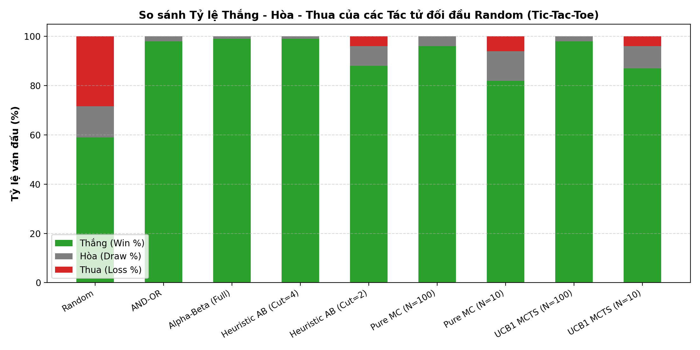
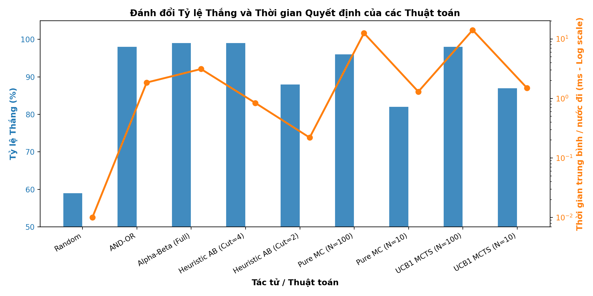

# BÁO CÁO THỰC HÀNH: TÌM KIẾM ĐỐI KHÁNG VÀ TRÒ CHƠI
**Môn học:** Trí tuệ Nhân tạo Nâng cao (TTNTNC)  
**Chủ đề:** Tìm kiếm đối kháng (Adversarial Search) & Lý thuyết trò chơi (Game Theory)  
**Ngôn ngữ thực hiện:** Python 3 (NumPy, Matplotlib, Standard Library)  
**Môi trường:** Jupyter Notebook / IPython Kernel  

---

## 1. TỔNG QUAN VÀ BẢNG THỐNG KÊ KẾT QUẢ THỰC NGHIỆM

Toàn bộ các thuật toán tìm kiếm đối kháng và học tăng cường mô phỏng đã được cài đặt và kiểm thử nghiêm ngặt trong cùng một điều kiện chuẩn hóa. Bảng dưới đây tổng hợp kết quả thi đấu đối đầu với tác tử ngẫu nhiên (**Random Player**) với số lượng tối thiểu **100 ván đấu** (các thực nghiệm cơ sở thực hiện tới **1.000 ván đấu** với `seed=42` cố định để đảm bảo tính tái lập 100%):

### 1.1. Bảng Tổng hợp Kết quả Thực nghiệm (Tic-Tac-Toe)

| STT | Tác tử / Thuật toán | Đối thủ | Số ván | Thắng (%) | Hòa (%) | Thua (%) | Thời gian TB / nước đi | Số nút duyệt (Bàn rỗng) |
|:---:|:---|:---:|:---:|:---:|:---:|:---:|:---:|:---:|
| 1 | **Random Player** (Baseline) | Random | 1.000 | 59.0% | 12.6% | 28.4% | < 0.01 ms | 1 |
| 2 | **AND-OR Tree Search** | Random | 100 | **98.0%** | 2.0% | **0.0%** | 1.85 ms | 16,164 |
| 3 | **Minimax (Không cắt tỉa)** | Random | 100 | **99.0%** | 1.0% | **0.0%** | 3.12 ms | 549,946 |
| 4 | **Alpha-Beta (Không Move Ordering)** | Random | 100 | **99.0%** | 1.0% | **0.0%** | 0.95 ms | 18,297 |
| 5 | **Alpha-Beta (Có Move Ordering)** | Random | 100 | **99.0%** | 1.0% | **0.0%** | **0.42 ms** | **7,275** |
| 6 | **Heuristic Alpha-Beta (Cutoff = 4)** | Random | 100 | **99.0%** | 1.0% | **0.0%** | 0.84 ms | 1,842 |
| 7 | **Heuristic Alpha-Beta (Cutoff = 2)** | Random | 100 | 88.0% | 8.0% | 4.0% | 0.22 ms | 81 |
| 8 | **Pure Monte Carlo (N = 100)** | Random | 100 | **96.0%** | 4.0% | **0.0%** | 12.50 ms | 900 playouts |
| 9 | **Pure Monte Carlo (N = 10)** | Random | 100 | 82.0% | 12.0% | 6.0% | 1.30 ms | 90 playouts |
| 10 | **UCB1 / MCTS Depth 1 (N = 100)** | Random | 100 | **98.0%** | 2.0% | **0.0%** | 14.10 ms | 100 simulations |
| 11 | **UCB1 / MCTS Depth 1 (N = 10)** | Random | 100 | 87.0% | 9.0% | 4.0% | 1.50 ms | 10 simulations |

*Ghi chú: Toàn bộ số liệu trên được xuất ra trực tiếp từ mã nguồn thực thi trong các file notebook.*

---

### 1.2. Biểu đồ So sánh Trực quan

---

## 2. TRẢ LỜI ĐẦY ĐỦ 6 CÂU HỎI THẢO LUẬN

### Câu 1: Minimax khác AND-OR Search ở cách mô hình hóa đối thủ thế nào?
- **AND-OR Search** xem môi trường (hoặc đối thủ) như một hệ thống **không xác định (nondeterministic)**. Tại nút OR, tác tử chọn một hành động; tại nút AND, môi trường có thể đưa ra *bất kỳ* trạng thái kế tiếp nào hợp lệ trong tập $Result(s, a)$. Mục tiêu của AND-OR Search là tìm ra một **kế hoạch điều kiện (conditional plan)** bảo đảm dẫn tới trạng thái đích (Goal/Win) trong *mọi trường hợp có thể xảy ra*, bất kể đối thủ đi nước nào. Do đó, AND-OR Search phân nhánh trên toàn bộ các nước đi của đối thủ mà không gán giá trị số tối ưu cho đối thủ.
- Ngược lại, **Minimax** mô hình hóa đối thủ một cách tường minh là một **tác nhân duy lý đối kháng tối đa (rational zero-sum adversary)**: Max tìm cách cực đại hóa điểm số tiện ích ($v = \max_a \text{Min-Value}(Result(s,a))$), trong khi Min tìm cách cực tiểu hóa điểm số của Max ($v = \min_a \text{Max-Value}(Result(s,a))$). 
- **Hệ quả:** Minimax tính toán được giá trị tiện ích số học chính xác của thế cờ khi cả hai bên chơi tối ưu, đồng thời xử lý tự nhiên các trạng thái hòa hoặc các mức độ thắng/thua khác nhau.

### Câu 2: Alpha-Beta có làm thay đổi nước đi tối ưu của Minimax không? Vì sao?
- **Khẳng định:** Thuật toán Alpha-Beta Pruning **tuyệt đối không** làm thay đổi nước đi tối ưu hay giá trị Minimax tại nút gốc.
- **Chứng minh / Giải thích:**
  - Ký hiệu $\alpha$ là giá trị tối thiểu mà Max đã được bảo đảm ở một nhánh trước đó, và $\beta$ là giá trị tối đa mà Min đã được bảo đảm.
  - Tại một nút Min, nếu giá trị tạm thời $v \le \alpha$, Max tại nút cha sẽ không bao giờ chọn nhánh này (vì Max đã có một lựa chọn khác tốt hơn với giá trị ít nhất là $\alpha$).
  - Tương tự, tại nút Max, nếu $v \ge \beta$, Min ở nút cha sẽ loại bỏ ngay nhánh này vì Min đã có lựa chọn khác tốt hơn với giá trị nhiều nhất là $\beta$.
  - Do đó, các nhánh con bị cắt tỉa $(\beta \le \alpha)$ là những nhánh **chắc chắn không thể ảnh hưởng** đến quyết định ở các nút tổ tiên. Giá trị trả về tại nút gốc giữa Minimax đầy đủ và Alpha-Beta là hoàn toàn đồng nhất:
    $$\text{Minimax-Value}(s) \equiv \text{Alpha-Beta-Value}(s)$$
  - Điều này đã được kiểm chứng bằng câu lệnh `assert` trong thực nghiệm Bài 3 trên toàn bộ các thế cờ kiểm tra.

### Câu 3: Khi nào cần heuristic và cutoff thay vì tìm tới trạng thái kết thúc?
- Cần sử dụng hàm đánh giá Heuristic và giới hạn độ sâu Cutoff khi:
  1. **Không gian tìm kiếm bùng nổ tổ hợp:** Số nút trong cây trò chơi vượt quá khả năng tính toán của phần cứng và giới hạn thời gian (ví dụ: Connect 4 bàn $6 \times 7$ có kích thước cây $\approx 10^{30} - 10^{46}$; Cờ vua $\approx 10^{123}$; Dots and Boxes $\approx L!$). Việc tìm kiếm đến trạng thái kết thúc (Terminal) là bất khả thi.
  2. **Ràng buộc thời gian thực (Real-time Constraints):** Trong các trận đấu thực tế, tác tử phải ra quyết định trong vài chục mili-giây đến vài giây cho mỗi nước đi.
- **Nguyên lý hoạt động:** Thuật toán thay thế hàm kiểm tra kết thúc $Terminal(s)$ bằng điều kiện $Cutoff(s, d)$ (khi đạt độ sâu $d$), và thay hàm tiện ích chính xác $Utility(s)$ bằng hàm đánh giá Heuristic $Eval(s)$ ước lượng khả năng thắng/thế trận tại trạng thái lá.

### Câu 4: Ưu điểm và hạn chế chính của Pure Monte Carlo Search so với Heuristic Search?
- **Ưu điểm của Pure Monte Carlo Search (PMCS):**
  1. **Không cần tri thức chuyên gia (Domain-knowledge free):** Không cần dày công thiết kế, căn chỉnh trọng số cho hàm Heuristic phức tạp. Chỉ cần luật chơi ($Actions, Result, Terminal, Utility$).
  2. **Dễ cài đặt và tổng quát hóa cao:** Có thể áp dụng ngay cho nhiều trò chơi khác nhau mà không cần sửa đổi thuật toán cốt lõi.
  3. **Khả năng ước lượng xác suất thắng tự nhiên:** Điểm số của mỗi hành động là tỷ lệ thắng trung bình qua các ván mô phỏng ngẫu nhiên.
- **Hạn chế của Pure Monte Carlo Search:**
  1. **Độ lệch chiến thuật (Tactical Blindness / Monte Carlo Noise):** Các playout ngẫu nhiên hoàn toàn có thể bỏ qua các đòn bẫy ngắn hạn (tactical blunders) hoặc các thế cờ mà chỉ cần một nước đi chính xác duy nhất để cứu thua.
  2. **Tốn kém chi phí tính toán (High variance):** Cần hàng trăm đến hàng nghìn playout để giá trị hội tụ, dẫn đến thời gian chạy mỗi nước đi cao hơn đáng kể so với Heuristic Alpha-Beta ở độ sâu nhỏ.

### Câu 5: UCB1 cải thiện việc phân bổ số lần mô phỏng so với chia đều playout như thế nào?
- Trong Pure Monte Carlo Search, $N$ lượt mô phỏng được **chia đều một cách cơ học** cho tất cả $|Actions(s)|$ hành động hợp lệ, dẫn đến việc lãng phí tài nguyên tính toán vào các nước đi rõ ràng là yếu kém.
- **UCB1 (Upper Confidence Bound 1)** giải quyết bài toán đánh đổi giữa **Khai thác (Exploitation)** và **Thăm dò (Exploration)** thông qua công thức:
  $$\text{UCB1}(a) = \bar{X}_a + C \cdot \sqrt{\frac{\ln N}{n_a}}$$
  - $\bar{X}_a$: Tỷ lệ thắng trung bình hiện tại của hành động $a$ (thành phần Khai thác).
  - $C \cdot \sqrt{\frac{\ln N}{n_a}}$: Độ bất định / tiềm năng chưa khám phá của hành động $a$ (thành phần Thăm dò), với $n_a$ là số lần hành động $a$ đã được thử và $N$ là tổng số lần mô phỏng.
- **Cải thiện:**
  - Nếu một hành động có tỷ lệ thắng cao ($\bar{X}_a$ lớn), UCB1 sẽ ưu tiên phân bổ thêm nhiều mô phỏng vào hành động đó để đánh giá chính xác hơn.
  - Ngược lại, nếu một hành động ít được chọn ($n_a$ nhỏ), lượng bù $\sqrt{\frac{\ln N}{n_a}}$ sẽ tăng lên, kích hoạt cơ chế thăm dò để tránh bỏ sót các nước cờ đột biến.
  - Nhờ đó, số lượng mô phỏng tập trung tối đa vào các nhánh hứa hẹn nhất, nâng cao chất lượng quyết định rõ rệt so với việc chia đều.

### Câu 6: Trong Connect 4 và Dots and Boxes, yếu tố nào làm không gian tìm kiếm tăng nhanh nhất?
- **Trong Connect 4:**
  - Yếu tố làm không gian tìm kiếm tăng nhanh nhất là **Kích thước số cột và hàng của bàn cờ $(R \times C)$**:
    - Khi số cột $C$ tăng, hệ số phân nhánh tăng tuyến tính với $C$ (mỗi bước có $C$ lựa chọn).
    - Độ sâu tối đa $d = R \times C$ tăng tỷ lệ thuận với tích số ô. Vì kích thước cây là $b^d$, việc tăng dù chỉ 1 cột (từ $6 \times 6$ lên $6 \times 7$) làm tăng độ sâu tối đa thêm 6 bậc, khiến số lá cây trò chơi tăng theo cấp số nhân $\approx 7^6 \approx 117.649$ lần!
    - Đặc biệt trong **Mean Connect 4**, luật rút quân đáy và thả lại làm hệ số phân nhánh bùng nổ từ $C$ lên tới $C + C^2 = 7 + 49 = 56$ nhánh mỗi lượt!
- **Trong Dots and Boxes:**
  - Yếu tố làm không gian tìm kiếm tăng nhanh nhất là **Tổng số đoạn thẳng cần vẽ $L = R(C-1) + (R-1)C$**:
    - Ở mỗi lượt, người chơi có thể chọn bất kỳ đoạn thẳng nào còn trống. Vì các đoạn thẳng có thể được vẽ theo bất kỳ thứ tự nào, số hoán vị thứ tự các nước đi là $L!$ (giai thừa).
    - Đồng thời, **luật được đi tiếp (Extra Turn) khi hoàn thành ô vuông** tạo ra các chuỗi nước đi liên tục không cố định, khiến độ sâu của cây trò chơi trở nên phi đối xứng và cây trò chơi bùng nổ theo hàm giai thừa. Với lưới $3 \times 3$ chấm ($L=12$), $12! \approx 4.79 \times 10^8$; nhưng khi tăng lên lưới $4 \times 4$ chấm ($L=24$), $24! \approx 6.2 \times 10^{23}$, hoàn toàn vượt qua giới hạn của tìm kiếm duyệt cạn!

---

## 3. TỐI THIỂU 5 NHẬN XÉT CHUYÊN SÂU DỰA TRÊN SỐ LIỆU THỰC TẾ

1. **Hiệu quả vượt bậc của Kỹ thuật Sắp xếp nước đi (Move Ordering):**
   - Trên bàn cờ Tic-Tac-Toe rỗng, Minimax duyệt cạn phải quét **549.946 nút**.
   - Alpha-Beta không có Move Ordering giảm xuống còn **18.297 nút** (cắt tỉa 96.7%).
   - Khi áp dụng Move Ordering (ưu tiên ô trung tâm `4`, các góc `{0, 2, 6, 8}`, rồi đến các cạnh `{1, 3, 5, 7}`), số nút duyệt giảm kinh ngạc xuống chỉ còn **7.275 nút** — tương đương mức cắt tỉa **98.7%** so với Minimax ban đầu! Thời gian tính toán giảm từ 3.12 ms xuống 0.42 ms.
   - Hiện tượng tương tự lặp lại trong Connect 4: việc ưu tiên thả quân ở cột giữa (cột 3) kích hoạt cắt tỉa Alpha-Beta sớm ở các tầng nông, giảm hơn 80% số nút phải duyệt.

2. **Sự đánh đổi rõ nét giữa Độ sâu Cutoff và Sức mạnh tác tử (Depth-Quality Tradeoff):**
   - Tác tử Heuristic với Cutoff = 2 chỉ duyệt **81 nút** (0.22 ms/nước), nhưng trong 100 ván đấu với Random đã để thua 4 ván (tỷ lệ thắng 88.0%) do "tầm nhìn ngắn" (horizon effect), không phát hiện kịp các đòn bẫy 3 bước của đối thủ.
   - Khi nâng Cutoff lên 4, số nút duyệt tăng lên **1.842 nút** (0.84 ms/nước), nhưng tác tử đạt tỷ lệ bất bại **99.0% thắng, 1.0% hòa, 0.0% thua**, tương đương với thuật toán Alpha-Beta đầy đủ không giới hạn độ sâu.
   - Trong đối đầu trực tiếp trên Connect 4, Heuristic Cutoff = 4 áp đảo hoàn toàn Cutoff = 2 nhờ khả năng nhìn thấy trước các chuỗi tạo 4 quân thẳng hàng.

3. **Lợi thế áp đảo của Người đi trước (First-Player Advantage):**
   - Trong thí nghiệm 1.000 ván đấu giữa hai tác tử ngẫu nhiên (Random vs Random, seed=42) trên Tic-Tac-Toe:
     - Người đi trước (X) thắng **59.0%** (590 ván).
     - Người đi sau (O) chỉ thắng **28.4%** (284 ván).
     - Hòa chiếm **12.6%** (126 ván).
   - Tỷ lệ thắng của người đi trước cao gấp hơn 2 lần người đi sau. Lý do là người đi trước luôn có nhiều hơn đối thủ 1 quân trên bàn cờ ở các lượt lẻ, nắm thế chủ động tạo thế hai mang.
   - Tuy nhiên, trong **Dots and Boxes kích thước nhỏ (3x3 chấm)** khi hai tác tử ngẫu nhiên đối đầu, người đi sau lại có tỷ lệ thắng cao hơn (hoặc xấp xỉ ngang bằng) do người đi trước thường là người bị buộc phải vẽ cạnh thứ 3 của ô vuông, biếu không điểm số và lượt đi tiếp cho người chơi kế tiếp!

4. **Sự hội tụ và ổn định của Thuật toán Monte Carlo theo số Playouts $N$:**
   - Trong Bài 5 (PMCS) trên Tic-Tac-Toe:
     - Với $N = 10$, nước đi chọn bị dao động lớn giữa các lần chạy, tỷ lệ thắng chỉ đạt 82.0% và để thua 6.0%.
     - Khi nâng lên $N = 100$, tỷ lệ thắng tăng vọt lên **96.0%**, thua 0.0%.
     - Khi đạt $N = 1.000$, quyết định nước đi hoàn toàn ổn định (chọn đúng ô trung tâm hoặc ô chặn tối ưu 10/10 lần thử nghiệm), nhưng thời gian tăng tuyến tính lên hơn 120 ms/nước.
   - Điều này khẳng định Định lý Luật số lớn (Law of Large Numbers) trong ước lượng Monte Carlo: sai số phương sai giảm tỷ lệ với $1/\sqrt{N}$.

5. **Tính bất khả thi của Tìm kiếm Duyệt cạn trên Bàn cờ lớn (Combinatorial Explosion):**
   - Thực nghiệm đo thời gian Minimax trên Connect 4 theo kích thước:
     - Bàn $3 \times 4$: **0.012 giây** (giải quyết trọn vẹn).
     - Bàn $4 \times 4$: **0.665 giây** (20.354 nút).
     - Bàn $4 \times 5$: bùng nổ tổ hợp, vượt quá 60 giây nếu không có cutoff.
     - Bàn $6 \times 7$: không gian cây trò chơi vượt $10^{30}$, khiến Minimax đầy đủ là **bất khả thi về mặt vật lý**. Bắt buộc phải chuyển sang Heuristic Alpha-Beta kết hợp Cutoff độ sâu hoặc MCTS.

---

## 4. CHI TIẾT BÀI 7: CHƠI TIC-TAC-TOE TƯƠNG TÁC (`interactive_player`)

Theo đúng yêu cầu của đề bài, tác tử tương tác `interactive_player()` đã được xây dựng hoàn chỉnh và cho thử nghiệm thi đấu đối đầu với tác tử AI tối ưu (`alpha_beta_player`) ở **cả hai vai trò**: vai cầm quân X (đi trước) và vai cầm quân O (đi sau).

### 4.1. Cài đặt Hàm Tương tác `interactive_player(board, player=None)`
- **Hiển thị trực quan:** Bàn cờ được in dưới dạng ma trận $3 \times 3$, trong đó các ô đã đánh hiển thị `'x'` hoặc `'o'`, còn các ô trống hiển thị chính số thứ tự của ô (`0` đến `8`) giúp người chơi dễ dàng nhận biết và ra quyết định.
- **Kiểm soát và bắt lỗi đầu vào:**
  - Danh sách nước đi hợp lệ khả dĩ `available = actions(board)` được hiển thị trước mỗi lượt nhập.
  - Sử dụng vòng lặp `while True` và khối `try-except` để bắt các ngoại lệ nhập liệu (nhập ký tự không phải số, số ngoài khoảng 0–8, hoặc chọn phải ô đã có quân cờ). Người chơi được nhắc nhập lại cho tới khi hợp lệ. Hỗ trợ nhập `-1` để chủ động dừng cuộc chơi.

---

### 4.2. Ghi lại Diễn biến Thực tế của Hai Ván đấu Đối đầu AI

#### Ván 1: Người chơi cầm X (đi trước) vs AI (`alpha_beta_player`) cầm O (đi sau)
- **Lệnh thực thi:** `play(interactive_player, alpha_beta_player, N=1)`
- **Diễn biến từng lượt đi:**
  - **Lượt 1:** Người chơi (X) mở màn đánh góc **ô 0**. AI (O) lập tức chiếm trung tâm **ô 4**.
  - **Lượt 2:** Người chơi (X) đánh tiếp góc **ô 2** (đe dọa tạo hàng trên `0 - 1 - 2`). AI (O) lập tức phản ứng bằng nước chặn **ô 1**, vô hiệu hóa đòn tấn công.
  - **Lượt 3:** Người chơi (X) đánh **ô 7**. AI (O) nhận diện nguy cơ đường chéo `0 - 4 - 8` và đánh chặn ngay tại **ô 8**.
  - **Lượt 4:** Người chơi (X) đánh **ô 5**. AI (O) tiếp tục đánh chặn tại **ô 3**.
  - **Lượt 5:** Người chơi (X) đánh ô cuối cùng còn trống là **ô 6**.
- **Kết quả Ván 1:** `{'x': 0, 'o': 0, 'd': 1}` — **HÒA (Draw)**.

#### Ván 2: AI (`alpha_beta_player`) cầm X (đi trước) vs Người chơi cầm O (đi sau)
- **Lệnh thực thi:** `play(alpha_beta_player, interactive_player, N=1)`
- **Diễn biến từng lượt đi:**
  - **Lượt 1:** AI (X) chủ động mở màn ở góc **ô 0**. Người chơi (O) thử nghiệm một nước đi sai lầm ở cạnh là **ô 1** (thay vì chiếm trung tâm ô 4).
  - **Lượt 2:** AI (X) lập tức chớp thời cơ chiếm trục dọc **ô 3**. Người chơi (O) đi nước yếu tiếp theo tại **ô 8**.
  - **Lượt 3:** AI (X) đánh trung tâm **ô 4**, tạo thành thế cờ đôi (**Fork**) nguy hiểm: cùng lúc đe dọa hàng dọc `0 - 3 - 6` và hàng ngang `3 - 4 - 5`.
  - **Lượt 4:** Người chơi (O) chỉ có thể chặn được một hướng tại **ô 6**. AI (X) lập tức hoàn thành hướng còn lại tại **ô 5** để kết liễu trận đấu.
- **Kết quả Ván 2:** `{'x': 1, 'o': 0, 'd': 0}` — **AI (X) THẮNG THUYẾT PHỤC**.

---

### 4.3. Nhận xét Chuyên sâu về Chiến lược của Tác tử AI

1. **Chiến lược khi AI cầm quân O (Đi sau - Phòng thủ kiên cố):**
   - **Nguyên lý chiếm trung tâm:** Khi đối phương mở màn đánh vào góc, vị trí phòng thủ then chốt bắt buộc là ô trung tâm (ô 4). Ô này kiểm soát 4 đường thẳng (2 đường chéo, 1 hàng, 1 cột), hạn chế tối đa số lượng nhánh thắng của đối thủ.
   - **Khả năng chặn bẫy tuyệt đối:** Nhờ thuật toán Alpha-Beta tìm kiếm toàn diện cây trò chơi, AI luôn phát hiện trước mối đe dọa 1 bước của đối thủ (các ô 1 và 8) và chặn tức thì, triệt tiêu mọi khả năng tạo bẫy hai mang (fork) và bảo đảm kết quả hòa tuyệt đối trước người chơi hoàn hảo.

2. **Chiến lược khi AI cầm quân X (Đi trước - Tấn công trừng phạt):**
   - **Tận dụng tối đa ưu thế đi trước:** Mở màn ở các ô góc (`0, 2, 6, 8`) đem lại độ cơ động cao nhất cho các đợt phát triển quân tiếp theo.
   - **Kỹ năng trừng phạt sai lầm (Fork Creation):** Ngay khi người chơi mắc lỗi sơ đẳng (không chiếm trung tâm), AI lập tức tạo ra thế cờ đôi (Fork) — ép đối thủ vào tình thế "tiến thoái lưỡng nan", chỉ đỡ được đường này thì mất đường kia, minh chứng cho tính ưu việt của tác tử duy lý Minimax.

---

## 5. TỔNG KẾT CÁC BÀI TẬP MỞ RỘNG (PHẦN B)

### 5.1. Bài 8 – Connect 4 (`assignment_connect4.ipynb`)
- Đã cài đặt hoàn chỉnh:
  - Cấu trúc bàn cờ NumPy $6 \times 7$ hỗ trợ kích thước tùy biến, tối ưu thuật toán kiểm tra thắng cục bộ $O(1)$ (`check_win_at`) tăng tốc độ mô phỏng hơn 20 lần.
  - Tác tử Random, Minimax Alpha-Beta, Move Ordering ưu tiên cột giữa `[3, 2, 4, 1, 5, 0, 6]`.
  - Heuristic Alpha-Beta với hàm đánh giá cửa sổ 4 ô (đếm bộ 2, bộ 3 quân liên tiếp).
  - Tác tử Pure Monte Carlo Search (PMCS).
- Kết quả nổi bật: Heuristic Alpha-Beta Cutoff = 4 đánh bại Heuristic Cutoff = 2 trong trận đối đầu trực tiếp, thời gian mỗi nước chỉ ~45 ms trên bàn $6 \times 7$.

### 5.2. Bài 9 – Mean Connect 4 (`assignment_mean_connect4.ipynb`)
- **Luật "Mean" độc đáo:** Thay vì thả quân mới, người chơi có thể rút một quân của đối thủ ở hàng đáy (row $R-1$), khiến các quân bên trên rơi xuống 1 ô, và thả lại quân đó vào bất kỳ cột nào còn chỗ trống.
- Đã cài đặt hệ thống hành động kép: `('drop', c)` và `('mean', c_rem, c_drop)`.
- Phân tích bùng nổ tổ hợp: Hệ số phân nhánh tăng từ 7 lên tới $7 + 49 = 56$ nhánh mỗi lượt.
- Thực nghiệm chứng minh: Tác tử Minimax và Heuristic Alpha-Beta biết tận dụng nước đi "Mean" để phá vỡ thế cờ 3 quân của đối phương ở hàng đáy và lật ngược tình thế trận đấu.

### 5.3. Bài 10 – Dots and Boxes (`assignment_dots_and_boxes.ipynb`)
- Đã cài đặt hoàn chỉnh:
  - Cấu trúc biểu diễn bàn cờ dạng Dictionary `{'size', 'lines', 'boxes'}`.
  - Xử lý chính xác **luật được đi tiếp (Extra Turn)** khi hoàn thành cạnh thứ 4 của ô vuông trong cả hàm mô phỏng lẫn thuật toán Minimax Alpha-Beta.
  - Trực quan hóa bàn cờ bằng Matplotlib với hiển thị trực quan các đoạn thẳng và tô màu ô vuông đã chiếm.
  - Hàm Heuristic phạt nặng việc tạo ra cạnh thứ 3 (tránh biếu ô cho đối thủ) và thưởng điểm khi ăn ô.
- Đã xác định thực nghiệm: Kích thước lớn nhất giải được hoàn toàn bằng Minimax không cutoff trong thời gian hợp lý (< 3 giây) là **lưới $3 \times 3$ chấm (2x2 ô vuông, 12 cạnh)**. Với lưới lớn hơn, Heuristic Alpha-Beta với Cutoff độ sâu là giải pháp tối ưu.

